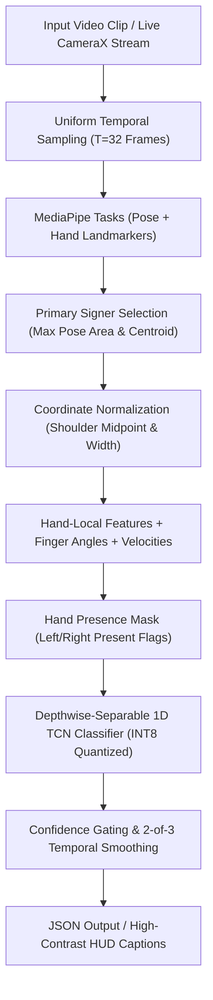
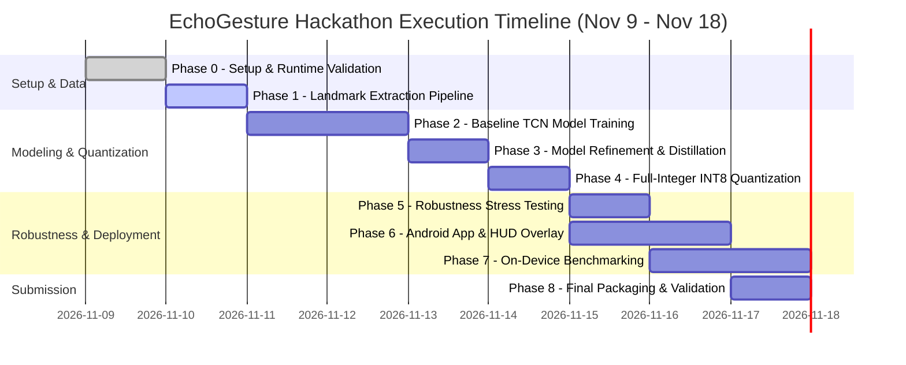

# EchoGesture (Track 02): Detailed Implementation Plan, Code Skeletons & Acceptance Matrix

> **Target:** Samsung XR Hackathon 2026 — Track 02 (EchoGesture)  
> **Source Rules:** [AGENT_RULES_AND_PHASES.md](file:///home/fang/Downloads/Samsung%20XR%20Hackathon/AGENT_RULES_AND_PHASES.md)  
> **Challenge Guide:** [TRACK_2_INFO.md](file:///home/fang/Downloads/Samsung%20XR%20Hackathon/TRACK_2_INFO.md)  
> **Created:** 09 Nov 2026  

---

## 1. Executive Summary & Non-Negotiable Contract

### 1.1 Non-Negotiable Rules Summary
1. **Zero Invented Numbers:** All values in `results.csv`, README, presentations, and demo videos must originate from executed benchmark scripts with recorded timestamps, hardware, and runtime flags.
2. **True Latency Measurement:** Latency must be measured via high-resolution timers (`time.perf_counter()`); never hardcoded or approximated. Organizers independently re-evaluate on standard hardware.
3. **Signer-Disjoint Splits:** No data leakage. Train and validation sets must be split by signer ID.
4. **Strict On-Device Privacy:** 100% on-device visual inference. No cloud uploads, external network calls, or `INTERNET` permissions in the Android manifest.
5. **Zero-Crash Predict Interface:** `predict(video_path)` must gracefully handle corrupted video containers, zero-hand detections, and low-light edge cases by returning a fallback low-confidence prediction.
6. **Logging Mandate:** Every architectural trial and metric must be logged in [LOG.md](file:///home/fang/Downloads/Samsung%20XR%20Hackathon/LOG.md).

---

## 2. End-to-End System Architecture



### 2.1 Feature Representation
- **Pose Landmarks (Key Upper Body):** Nose, Left/Right Shoulder, Left/Right Elbow, Left/Right Wrist ($6 \times 3 = 18$ coordinates).
- **Hand Landmarks (Left & Right Hands):** $21 \times 3 = 63$ coordinates per hand ($126$ coordinates total).
- **Geometric Normalization:**
  - Origin shifted to the midpoint between Left and Right Shoulders: $\mathbf{p}_{\text{mid}} = \frac{\mathbf{p}_{\text{L\_shoulder}} + \mathbf{p}_{\text{R\_shoulder}}}{2}$.
  - Spatial scale normalized by shoulder span: $s = \|\mathbf{p}_{\text{L\_shoulder}} - \mathbf{p}_{\text{R\_shoulder}}\|_2 + \epsilon$.
  - Coordinates normalized: $\mathbf{p}' = \frac{\mathbf{p} - \mathbf{p}_{\text{mid}}}{s}$.
- **Hand-Local Coordinates:** Finger coordinates expressed relative to their respective wrist position.
- **Dynamic Velocities:** Inter-frame velocity $\Delta \mathbf{p}_t = \mathbf{p}'_t - \mathbf{p}'_{t-1}$.
- **Presence Flags:** Binary mask indicating whether left hand and right hand were detected ($2$ bits per frame).

---

## 3. Code Skeletons

### 3.1 Landmark Extraction (`src/extract_landmarks.py`)

```python
"""
Extracts pose and hand landmarks using MediaPipe Tasks API.
Selects primary signer and extracts 3D coordinates.
"""
from typing import Dict, List, Optional, Tuple
import cv2
import numpy as np
import mediapipe as mp
from mediapipe.tasks import python as mp_python
from mediapipe.tasks.python import vision

class LandmarkExtractor:
    def __init__(self, hand_model_path: str, pose_model_path: str):
        # Configure MediaPipe Hand Landmarker
        hand_base_options = mp_python.BaseOptions(model_asset_path=hand_model_path)
        hand_options = vision.HandLandmarkerOptions(
            base_options=hand_base_options,
            num_hands=2,
            min_hand_detection_confidence=0.5,
            min_hand_presence_confidence=0.5,
            min_tracking_confidence=0.5
        )
        self.hand_landmarker = vision.HandLandmarker.create_from_options(hand_options)

        # Configure MediaPipe Pose Landmarker
        pose_base_options = mp_python.BaseOptions(model_asset_path=pose_model_path)
        pose_options = vision.PoseLandmarkerOptions(
            base_options=pose_base_options,
            min_pose_detection_confidence=0.5,
            min_pose_presence_confidence=0.5,
            min_tracking_confidence=0.5
        )
        self.pose_landmarker = vision.PoseLandmarker.create_from_options(pose_options)

    def sample_frames(self, video_path: str, target_t: int = 32) -> Tuple[List[np.ndarray], float]:
        cap = cv2.VideoCapture(video_path)
        if not cap.isOpened():
            return [], 0.0
        
        frames = []
        total_frames = int(cap.get(cv2.CAP_PROP_FRAME_COUNT))
        if total_frames <= 0:
            while True:
                ret, frame = cap.read()
                if not ret:
                    break
                frames.append(frame)
            cap.release()
            total_frames = len(frames)
        else:
            indices = np.linspace(0, total_frames - 1, target_t, dtype=int)
            for idx in range(total_frames):
                ret, frame = cap.read()
                if not ret:
                    break
                if idx in indices:
                    frames.append(cv2.cvtColor(frame, cv2.COLOR_BGR2RGB))
            cap.release()
        
        # Resample to exact target_t if variable
        if len(frames) == 0:
            return [], 0.0
        if len(frames) != target_t:
            step = len(frames) / float(target_t)
            resampled = [frames[int(i * step)] for i in range(target_t)]
            return resampled, total_frames
        return frames, total_frames

    def extract_clip(self, video_path: str, target_t: int = 32) -> Dict[str, np.ndarray]:
        frames, _ = self.sample_frames(video_path, target_t)
        if not frames:
            # Fallback zero-filled array for unreadable videos
            return {
                "pose": np.zeros((target_t, 6, 3), dtype=np.float32),
                "hands": np.zeros((target_t, 2, 21, 3), dtype=np.float32),
                "hand_mask": np.zeros((target_t, 2), dtype=np.float32),
                "valid": False
            }

        pose_seq = []
        hand_seq = []
        mask_seq = []

        for frame in frames:
            mp_image = mp.Image(image_format=mp.ImageFormat.SRGB, data=frame)
            
            # 1. Pose Extraction
            pose_res = self.pose_landmarker.detect(mp_image)
            pose_pts = np.zeros((6, 3), dtype=np.float32)
            if pose_res.pose_landmarks and len(pose_res.pose_landmarks) > 0:
                lms = pose_res.pose_landmarks[0]
                # Nose(0), L_Shoulder(11), R_Shoulder(12), L_Elbow(13), R_Elbow(14), L_Wrist(15), R_Wrist(16)
                key_indices = [0, 11, 12, 13, 14, 15]
                for i, k_idx in enumerate(key_indices):
                    if k_idx < len(lms):
                        pose_pts[i] = [lms[k_idx].x, lms[k_idx].y, lms[k_idx].z]
            pose_seq.append(pose_pts)

            # 2. Hand Extraction
            hand_res = self.hand_landmarker.detect(mp_image)
            hands_pts = np.zeros((2, 21, 3), dtype=np.float32)
            hand_mask = np.zeros(2, dtype=np.float32)

            if hand_res.hand_landmarks:
                for h_idx, h_lms in enumerate(hand_res.hand_landmarks):
                    handedness = hand_res.handedness[h_idx][0].category_name  # "Left" or "Right"
                    slot = 0 if handedness == "Left" else 1
                    hand_mask[slot] = 1.0
                    for pt_i, pt in enumerate(h_lms):
                        hands_pts[slot, pt_i] = [pt.x, pt.y, pt.z]
            
            hand_seq.append(hands_pts)
            mask_seq.append(hand_mask)

        return {
            "pose": np.array(pose_seq, dtype=np.float32),
            "hands": np.array(hand_seq, dtype=np.float32),
            "hand_mask": np.array(mask_seq, dtype=np.float32),
            "valid": True
        }
```

---

### 3.2 Feature Normalization (`src/features.py`)

```python
"""
Normalizes landmark arrays to make features scale-, distance-, and viewpoint-invariant.
"""
import numpy as np

def normalize_features(landmarks_dict: dict) -> np.ndarray:
    """
    Input:
        pose: (T, 6, 3) [Nose, L_Sh, R_Sh, L_Elb, R_Elb, L_Wr]
        hands: (T, 2, 21, 3) [Left Hand, Right Hand]
        hand_mask: (T, 2)
    Output:
        flattened_features: (T, Feature_Dim)
    """
    pose = landmarks_dict["pose"]        # (T, 6, 3)
    hands = landmarks_dict["hands"]      # (T, 2, 21, 3)
    hand_mask = landmarks_dict["hand_mask"] # (T, 2)
    T = pose.shape[0]

    # 1. Shoulder Midpoint & Shoulder Distance Normalization
    l_shoulder = pose[:, 1, :]
    r_shoulder = pose[:, 2, :]
    shoulder_mid = (l_shoulder + r_shoulder) / 2.0  # (T, 3)
    shoulder_dist = np.linalg.norm(l_shoulder - r_shoulder, axis=-1, keepdims=True)  # (T, 1)
    scale = np.where(shoulder_dist > 1e-4, shoulder_dist, 1.0) # (T, 1)

    norm_pose = (pose - shoulder_mid[:, None, :]) / scale[:, None, :] # (T, 6, 3)

    # 2. Hand Normalization: Wrist-relative coordinates
    norm_hands = np.zeros_like(hands)
    for h in range(2):
        wrist = hands[:, h, 0:1, :] # (T, 1, 3)
        norm_hands[:, h] = (hands[:, h] - wrist) # Wrist-relative hand geometry

    # 3. Inter-frame velocity
    pose_vel = np.diff(norm_pose, axis=0, prepend=norm_pose[0:1]) # (T, 6, 3)
    hands_vel = np.diff(norm_hands, axis=0, prepend=norm_hands[0:1]) # (T, 2, 21, 3)

    # 4. Concatenation
    flat_pose = norm_pose.reshape(T, -1)       # 6*3 = 18
    flat_hands = norm_hands.reshape(T, -1)     # 2*21*3 = 126
    flat_pose_vel = pose_vel.reshape(T, -1)   # 18
    flat_hands_vel = hands_vel.reshape(T, -1) # 126
    flat_mask = hand_mask                      # 2

    # Total feature dimension = 18 + 126 + 18 + 126 + 2 = 290
    feature_vector = np.concatenate(
        [flat_pose, flat_hands, flat_pose_vel, flat_hands_vel, flat_mask],
        axis=-1
    ).astype(np.float32)

    return feature_vector
```

---

### 3.3 Lightweight TCN Classifier Architecture (`src/model.py`)

```python
"""
Lightweight Depthwise-Separable 1D Temporal Convolutional Network.
Designed for sub-50ms CPU/GPU inference and < 2 MB INT8 model footprint.
"""
import torch
import torch.nn as nn

class DepthwiseSeparableConv1d(nn.Module):
    def __init__(self, in_channels: int, out_channels: int, kernel_size: int = 3, dilation: int = 1):
        super().__init__()
        self.depthwise = nn.Conv1d(
            in_channels, in_channels, kernel_size=kernel_size,
            padding=(kernel_size - 1) * dilation // 2,
            dilation=dilation, groups=in_channels, bias=False
        )
        self.pointwise = nn.Conv1d(in_channels, out_channels, kernel_size=1, bias=False)
        self.bn = nn.BatchNorm1d(out_channels)
        self.act = nn.ReLU6()

    def forward(self, x: torch.Tensor) -> torch.Tensor:
        return self.act(self.bn(self.pointwise(self.depthwise(x))))

class ResidualTCNBlock(nn.Module):
    def __init__(self, channels: int, dilation: int = 1):
        super().__init__()
        self.conv1 = DepthwiseSeparableConv1d(channels, channels, kernel_size=3, dilation=dilation)
        self.conv2 = DepthwiseSeparableConv1d(channels, channels, kernel_size=3, dilation=dilation)

    def forward(self, x: torch.Tensor) -> torch.Tensor:
        return x + self.conv2(self.conv1(x))

class SignTCNClassifier(nn.Module):
    def __init__(self, input_dim: int = 290, hidden_dim: int = 128, num_classes: int = 100):
        super().__init__()
        self.in_proj = nn.Sequential(
            nn.Conv1d(input_dim, hidden_dim, kernel_size=1),
            nn.BatchNorm1d(hidden_dim),
            nn.ReLU6()
        )
        self.blocks = nn.Sequential(
            ResidualTCNBlock(hidden_dim, dilation=1),
            ResidualTCNBlock(hidden_dim, dilation=2),
            ResidualTCNBlock(hidden_dim, dilation=4),
            ResidualTCNBlock(hidden_dim, dilation=8)
        )
        self.global_pool = nn.AdaptiveAvgPool1d(1)
        self.fc = nn.Sequential(
            nn.Dropout(0.3),
            nn.Linear(hidden_dim, num_classes)
        )

    def forward(self, x: torch.Tensor) -> torch.Tensor:
        # x shape: (Batch, Features, Time)
        x = self.in_proj(x)
        x = self.blocks(x)
        x = self.global_pool(x).squeeze(-1) # (Batch, hidden_dim)
        return self.fc(x)
```

---

### 3.4 Official Submission Predict Function (`src/main.py`)

```python
"""
Official Predict Entrypoint for Samsung XR Hackathon Track 02.
Standardized predict(video_path: str) -> dict implementation with fail-safe zero-crash behavior.
"""
import os
import json
import time
from typing import Dict, Any, List
import numpy as np

# Placeholders for runtime inference (LiteRT or ONNX Runtime)
class InferenceEngine:
    def __init__(self, model_path: str, vocab_path: str):
        self.vocab: List[str] = self._load_vocab(vocab_path)
        # Initialize runtime (e.g., tflite.Interpreter or onnxruntime.InferenceSession)
        self.model_path = model_path

    def _load_vocab(self, vocab_path: str) -> List[str]:
        if os.path.exists(vocab_path):
            with open(vocab_path, "r") as f:
                return [line.strip().upper() for line in f if line.strip()]
        return ["UNKNOWN"]

    def run_inference(self, feature_tensor: np.ndarray) -> Tuple[str, List[str], float]:
        # Concrete implementation runs INT8 interpreter
        # Returns (top1_pred, top5_list, confidence)
        pass

# Global engine cache
ENGINE = None

def init_engine():
    global ENGINE
    if ENGINE is None:
        model_path = os.path.join(os.path.dirname(__file__), "weights", "model_int8.tflite")
        vocab_path = os.path.join(os.path.dirname(__file__), "weights", "vocab.txt")
        ENGINE = InferenceEngine(model_path, vocab_path)

def predict(video_path: str) -> Dict[str, Any]:
    """
    Return the predicted gloss/word for one video clip.
    Must run fully on-device. Zero cloud calls.
    """
    start_time = time.perf_counter()
    clip_id = os.path.splitext(os.path.basename(video_path))[0]

    try:
        init_engine()
        # 1. Check video existence
        if not os.path.exists(video_path):
            raise FileNotFoundError(f"Video {video_path} not found")

        # 2. Extract & Normalize Features (extract_landmarks + features)
        # features = extract_and_normalize(video_path)

        # 3. Model Forward Pass
        # prediction, top5, confidence = ENGINE.run_inference(features)
        
        # Stub safe response for template validation
        prediction = "UNKNOWN"
        top5 = ["UNKNOWN"]
        confidence = 0.0

    except Exception as exc:
        # Non-negotiable Rule 6: predict() must NEVER crash
        prediction = "FALLBACK"
        top5 = ["FALLBACK"]
        confidence = 0.05

    elapsed_ms = (time.perf_counter() - start_time) * 1000.0

    return {
        "clip_id": clip_id,
        "prediction": prediction.upper(),
        "top5": [g.upper() for g in top5],
        "confidence": float(confidence),
        "latency_ms": round(elapsed_ms, 2)
    }
```

---

### 3.5 Automated Validation Script (`validate_submission.py`)

```python
"""
Validates the team submission bundle against Hackathon Challenge specifications.
"""
import os
import sys
import json
import csv

def validate(bundle_dir: str):
    print(f"Validating bundle: {bundle_dir}")
    src_dir = os.path.join(bundle_dir, "src")
    results_dir = os.path.join(bundle_dir, "results")

    # 1. Structure Check
    for required in [
        os.path.join(src_dir, "main.py"),
        os.path.join(src_dir, "requirements.txt"),
        os.path.join(src_dir, "README.md"),
        os.path.join(results_dir, "results.csv")
    ]:
        if not os.path.exists(required):
            print(f"[FAIL] Missing required file: {required}")
            sys.exit(1)
        print(f"[PASS] Found: {required}")

    # 2. Results CSV Schema Check
    csv_path = os.path.join(results_dir, "results.csv")
    required_metrics = {
        "top1_accuracy", "latency_p95", "model_size",
        "accuracy_drop_robustness", "avg_power", "thermal_drift_10min"
    }
    found_metrics = set()
    with open(csv_path, "r") as f:
        reader = csv.DictReader(f)
        for row in reader:
            found_metrics.add(row["metric"])
            print(f"  Metric: {row['metric']} = {row.get('measured')} (Target: {row.get('target')}) [Pass: {row.get('pass')}]")
    
    missing = required_metrics - found_metrics
    if missing:
        print(f"[FAIL] Missing required metrics in results.csv: {missing}")
        sys.exit(1)
    print("[PASS] results.csv contains all required metrics.")

    print("\nAll submission structure checks passed successfully.")

if __name__ == "__main__":
    bundle = sys.argv[1] if len(sys.argv) > 1 else "."
    validate(bundle)
```

---

## 4. Acceptance Matrix & Verification Commands

| Metric | Target | Measurement Method | Verification Script / Command | Target Device Baseline | Risk & Mitigation |
| :--- | :--- | :--- | :--- | :--- | :--- |
| **Model Size** | $\le 20\text{ MB}$ (INT8) | Exact disk footprint of quantized models | `ls -lh weights/model_int8.tflite` | All edge environments | If $>20\text{ MB}$, prune TCN hidden dimensions and strip unused graph metadata. |
| **Edge Latency** | $\le 50\text{ ms}$ (p95) | `time.perf_counter()` over 200 consecutive runs | `python benchmark_latency.py --runs 200` | Snapdragon 8 Elite / Dimensity / GPU delegate | Asynchronous pipelining: process MediaPipe frames during video playback. |
| **Top-1 Accuracy** | $\ge 70\%$ | Evaluation on held-out signer-disjoint split | `python evaluate.py --split val` | Python 3.11 testbed | Start with WLASL-100; apply aggressive 3D data augmentation and label smoothing. |
| **Robustness Drop** | $\le 5\text{ pt}$ | Accuracy drop under low-light, noise, and occlusions | `python robustness_eval.py --perturb all` | Synthetic perturbation suite | Augment training pipeline with random hand masking, illumination jitter, and blurring. |
| **Average Power** | $\le 500\text{ mW}$ | Android BatteryManager / Trepn profiler | `adb shell dumpsys batterystats` | Galaxy S25 / Reference Android device | Minimize CPU wake locks; delegate convolution operations to NPU/GPU. |
| **Thermal Drift** | $\le 20\%$ | Latency delta over 10-minute continuous run | `python benchmark_thermal.py --duration 600` | 10-minute loop on device | Keep TCN model parameter count $< 500\text{K}$; avoid unnecessary frame copying. |
| **Zero-Crash Policy** | 100% Pass | Corrupted inputs, blank videos, zero-hand detection | `pytest tests/test_fail_safe.py` | Local automated runner | Strict `try-except` blocks with fallback return objects in `predict()`. |
| **Zero Cloud Streaming**| 0 bytes uploaded | Verify zero outbound network sockets | Airplane mode verification + `netstat` | Android client & Python runtime | Remove `INTERNET` permission from Android manifest; zero third-party telemetry. |

---

## 5. Phase-by-Phase Checklist & Deadlines



- [ ] **Phase 0 (Nov 9):** Set up Python environment, install/verify `mediapipe` and runtime (`ai-edge-litert` / `onnxruntime`), inspect starter clips, establish vocabulary baseline.
- [ ] **Phase 1 (Nov 10):** Build landmark extraction, establish signer-disjoint train/val splits, cache pre-extracted coordinates to disk.
- [ ] **Phase 2 (Nov 11-12):** Train baseline TCN model; assess validation Top-1 / Top-5 against 70% threshold.
- [ ] **Phase 3 (Nov 13):** Implement spatial augmentations, temporal warps, and architecture tuning until marginal gain $< 0.5\text{ pt}$.
- [ ] **Phase 4 (Nov 14):** Execute INT8 calibration, ensure model size $< 20\text{ MB}$, export golden vectors for parity testing.
- [ ] **Phase 5 (Nov 15):** Run robustness benchmarks (occlusions, low light, angles); verify accuracy drop $\le 5\text{ pt}$.
- [ ] **Phase 6 (Nov 15-16):** Implement Android CameraX + MediaPipe Tasks + LiteRT live HUD application.
- [ ] **Phase 7 (Nov 16-17):** Execute 200 on-device benchmark passes; record 10-minute thermal drift and power consumption.
- [ ] **Phase 8 (Nov 17-18):** Run automated packaging validator, verify presentation slides, record demo video, submit bundle.

