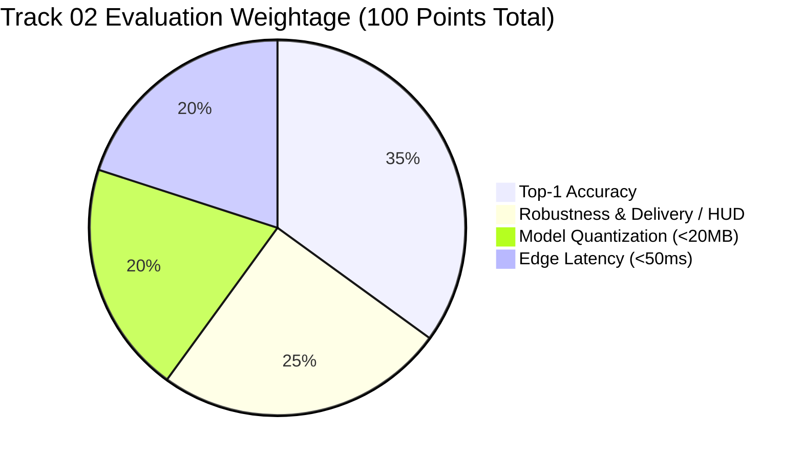

# Samsung XR Hackathon 2026: Complete Guide & Track 02 Specifications

> **Event:** HACKATHON CHALLENGE 2026 — *Innovate. Collaborate. Build.*  
> **Organizers:** XR Perception Group & PRISM Team, Samsung R&D Institute India, Bangalore (SRI-B)  
> **Official Contact / Queries:** `prism@samsung.com`  
> **Registration Link:** [https://forms.gle/oGBXsydqbhE3HS2o9](https://forms.gle/oGBXsydqbhE3HS2o9)  

---

## 1. General Hackathon Information

### 1.1 Overview & Purpose
The Samsung XR Hackathon 2026 is organized by the XR Perception Group and PRISM Team at Samsung R&D Institute India, Bangalore (SRI-B). The hackathon challenges student teams to solve cutting-edge, real-world problems in Extended Reality (XR), computer vision, and edge computing across four core tracks.

### 1.2 Important Timeline & Key Dates

| Milestone | Date / Deadline | Details |
| :--- | :--- | :--- |
| **Launch** | **05 Nov 2026** | Problem statements released; team registration opens |
| **Registration Closes** | **08 Nov 2026 (11:59 PM)** | Team registration deadline via Google Form |
| **Final Submission Closes** | **18 Nov 2026 (11:59 PM)** | Code, demo video, presentation deck due. **Strictly no extensions.** |
| **Top 15 Announced** | **23 Nov 2026** | Shortlisted teams advancing to the final demo round |
| **Final Demo Round** | **27 Nov 2026** | Top 15 teams present their live solution to the Samsung R&D jury |
| **Final Results** | **02 Dec 2026** | Winners announced; awards and next steps |

> **Critical Notice on Submissions:** The Final Submission Link will **ONLY** be shared with teams who have successfully completed the initial Team Registration by 8 Nov 2026, 11:59 PM.

---

### 1.3 Eligibility & Team Rules
- **Team Size:** Up to a maximum of **4 members**.
- **Institution:** Single college per team (all members must belong to the same college/institution).
- **Team Naming Convention:** Strict format: `CollegeName_TeamName`.
- **Per-Member Information Required:**
  - Full Name
  - Email Address
  - Phone Number
  - Year of Study & Academic Branch
- **Track Scope:** One theme/track per team (only one final submission per team).

---

### 1.4 Prizes & Opportunities

1. **Cash Prizes:**
   - Total prize pool worth **₹1,00,000 (₹1.0 Lakh)** awarded across the **Top 4 teams**.
2. **Certificates:**
   - **Participation Certificates:** Awarded to all *shortlisted teams* that appear for the final demo round.
   - **Merit Certificates:** Awarded to winning teams.
3. **PRISM Worklet Opportunity:**
   - Winning teams gain the opportunity to work on a **PRISM worklet** directly with a Samsung mentor (subject to mentor, student, and problem statement availability).
4. **Samsung R&D Summer Internship:**
   - **Two-month summer internship** at Samsung R&D Institute India, Bangalore (SRI-B) for selected students.
   - *Note:* Selected students may be required to clear the **MAGPIE Coding Test**.

---

## 2. Track 02 Deep Dive: EchoGesture

### 2.1 Track Identity & Core Scope
- **Track Name:** Track 02 — EchoGesture: Sign Language Prediction on Edge Device
- **Focus Area:** XR Perception Group, SRI-B
- **High-Level Objective:** Build a fully on-device, exocentric (third-person) sign language translation pipeline that takes live smartphone camera video and translates it to text or audio captions in real time.

---

### 2.2 Core Motivation & The Two Central Gaps

Natural conversation using sign language in XR and edge environments is blocked by two fundamental engineering bottlenecks:

1. **The Conversation Gap (Latency & Fluidity):**
   - Natural signing cadence is rapid.
   - Translation must operate with **$\le 50\text{ ms}$ latency**; otherwise, dialogue turns disjointed, unnatural, and out of sync with real-time communication.
2. **The On-Device Privacy Principle (Zero Cloud Visual Streaming):**
   - In third-person (exocentric) scenarios, camera feeds inevitably capture innocent bystanders in the background.
   - Strict privacy imperatives mandate that **all visual processing stays on-device**.
   - **Zero raw video or image data may be uploaded or streamed to the cloud.**

---

### 2.3 Challenge Abstract
- Build a lightweight, end-to-end translation pipeline running directly on wearable edge processors / mobile edge devices.
- Input: Live smartphone/wearable camera video feed (exocentric view).
- Output: Translated text or speech audio for bidirectional, two-way conversational support.
- Execution requirement: Operates continuously in real time **without battery drain or thermal throttling**.

---

### 2.4 Official Datasets & Resources Provided
Organizers specify two primary datasets and baseline resources:
1. **How2Sign:** Multimodal, large-scale American Sign Language (ASL) dataset with **80+ hours** of conversational signing.
2. **WLASL (Word-Level American Sign Language):** Over **2,000 sign language words / glosses**.
3. **Starter Baselines:** Provided by the hackathon organizers to bootstrap model development.

---

### 2.5 Key Constraints & Architecture Requirements

| Domain | Specification / Constraint |
| :--- | :--- |
| **Camera Viewpoint** | **Exocentric (Third-Person):** Must be resilient to moving heads, variable signer angles, and varying/low-light ambient conditions. |
| **Hand Representation** | Pose-invariant **3D hand features** (robust against self-occlusions and viewpoint changes). |
| **Privacy Boundary** | **100% on-device processing.** Zero cloud streaming of raw visual telemetry. |
| **Model Size Budget** | **$< 20\text{ MB}$ quantized model** using **INT8 quantization** (Results benchmark target lists $\le 25\text{ MB}$). |
| **Inference Latency Budget** | **$\le 50\text{ ms}$** 95th-percentile (p95) execution time. |
| **Runtime & Acceleration** | Optimized for mobile runtimes: **LiteRT (TensorFlow Lite)** or **ONNX Runtime**, leveraging mobile GPU / NPU delegates. |
| **Thermal & Power Budgets** | Average power consumption **$\le 500\text{ mW}$**; 10-minute continuous run thermal drift **$\le 20\%$**. |
| **Accuracy Targets** | Top-1 accuracy **$\ge 70\%$** on test data; accuracy drop under robustness test conditions **$\le 5\text{ points}$**. |
| **User Interface** | Clear heads-up display (HUD) captions or synthesized audio output for two-way communication. |

---

## 3. Judging Criteria & 100-Point Jury Matrix

Submissions for Track 02 are formally evaluated against a **100-Point Jury Matrix** divided into two major pillars:



### Breakdown of Evaluation Rubric

#### Pillar 1: Execution & Efficiency — 40% (40 Points)
*Focuses on deployment efficiency on target edge hardware.*
1. **Model Quantization (20% / 20 Points):**
   - Successful conversion and compilation into TFLite / LiteRT / ONNX Runtime.
   - Strict size verification: binary footprint must be **$< 20\text{ MB}$ (INT8)**.
2. **Edge Latency (20% / 20 Points):**
   - Measured per-clip inference time strictly **$< 50\text{ ms}$**.
   - Note: While participants self-report latency, **evaluators re-measure independently** on their own standardized evaluation device (e.g., Galaxy S25 / Snapdragon 8 Elite).

#### Pillar 2: Quality & Accuracy — 60% (60 Points)
*Focuses on translation accuracy, robustness, and presentation.*
1. **Top-1 Accuracy (35% / 35 Points):**
   - Prediction precision on an unreleased, held-out evaluation test set of video clips.
2. **Robustness & Delivery / HUD Clarity (25% / 25 Points):**
   - Robustness under difficult conditions: severe hand occlusions, low lighting, angled signers, and camera jitter.
   - Quality and readability of the two-way conversation interface (captions, HUD overlay, audio clarity).

---

## 4. Code Contract & Technical Interfaces

Evaluators execute your code automatically through a standardized Python function interface.

### 4.1 Required Python Inference Function
In `src/main.py`, teams must implement the exact function:

```python
def predict(video_path: str) -> dict:
    """
    Return the predicted gloss/word for one video clip.
    Must run fully on-device.
    """
```

### 4.2 Output JSON Specification
The `predict()` function must return a JSON dictionary matching this exact schema:

```json
{
  "clip_id": "test_0412",
  "prediction": "HAPPY",
  "top5": ["HAPPY", "HAND", "HOUSE", "HELP", "HOME"],
  "confidence": 0.81,
  "latency_ms": 23.4
}
```

#### Field Specifications:
- **`clip_id`** *(string, required)*: Must match the test manifest identifier exactly.
- **`prediction`** *(string, required)*: The predicted gloss/word from the fixed vocabulary list, formatted in **UPPERCASE**.
- **`top5`** *(array of strings, optional)*: Top 5 predicted candidate glosses in descending order of confidence; used by organizers to compute top-5 accuracy.
- **`confidence`** *(float, required)*: Model confidence score (e.g. `0.0` to `1.0`).
- **`latency_ms`** *(float, required)*: Self-reported inference duration in milliseconds.

---

### 4.3 Batch Prediction Output File (`predictions.jsonl`)
- Teams must submit a single **`predictions.jsonl`** file (or `predictions.json` as organized under `results/`).
- Format: **JSON Lines** (one valid JSON object per line, one line per test clip in the evaluation manifest).
- Automated validator checks:
  1. Every clip ID from the test manifest is present.
  2. Prediction vocabulary matches supported classes.
  3. No empty or non-conforming JSON lines.

---

### 4.4 Self-Reported Benchmark Results Sheet (`results.csv`)
A CSV file located at `results/results.csv` tracking all target performance metrics:

```csv
metric,target,measured,unit,device,runtime,pass
top1_accuracy,>=70,,%,,,
latency_p95,<=50,,ms,,,
model_size,<=25,,MB,,,
accuracy_drop_robustness,<=5,,pt,,,
avg_power,<=500,,mW,,,
thermal_drift_10min,<=20,,%,,,
```

#### Metric Specifications & Targets:
| Metric Key | Description | Target Value | Unit |
| :--- | :--- | :--- | :--- |
| `top1_accuracy` | Classification accuracy on evaluation set | **$\ge 70$** | `%` |
| `latency_p95` | 95th-percentile inference latency | **$\le 50$** | `ms` |
| `model_size` | Compiled quantized model storage footprint | **$\le 25$** (Key budget states $<20$) | `MB` |
| `accuracy_drop_robustness` | Drop in accuracy under stress / occluded tests | **$\le 5$** | `pt` (percentage points) |
| `avg_power` | Mean power draw during active prediction | **$\le 500$** | `mW` |
| `thermal_drift_10min` | Performance degradation / throttling after 10 min | **$\le 20$** | `%` |

- **`device` Column:** Specify hardware benchmarked (e.g., `"Galaxy S25, Snapdragon 8 Elite"`).
- **`runtime` Column:** Specify acceleration stack (e.g., `"LiteRT INT8, GPU delegate"` or `"ONNX Runtime INT8, NNAPI"`).
- **`pass` Column:** Populated with `TRUE` or `FALSE` by comparing `measured` against `target`.

---

## 5. Submission Package Structure & Automated Evaluation

### 5.1 Submission Bundle Layout (`team_name.zip`)
Submissions must strictly conform to the following directory hierarchy. **Non-standard layouts will fail automated evaluation pipelines directly.**

```text
team_name.zip
├── src/
│   ├── requirements.txt         # Package dependencies for Python 3.11
│   ├── main.py                  # Entry point exposing the predict() function
│   └── README.md                # Compilation, dependencies, and execution guide
└── results/
    ├── predictions.jsonl        # Prediction JSONL (one JSON line per test clip)
    └── results.csv              # Self-reported benchmark results sheet
```

### 5.2 Automated Evaluation Rules
- **Environment:** Scripts must execute cleanly in a standardized **Python 3.11** environment.
- **Reproducibility:** All inference logic, feature extractors, and weights must run locally within `src/` without downloading external runtime assets or calling external APIs.
- **Held-Out Evaluation:** The jury will run `predict()` on an unreleased, held-out test dataset to compute final Top-1 and Top-5 accuracy and measure actual hardware latency.

---

## 6. Final Submission Checklist & Deliverables

Every team must prepare and submit the following components via the official submission Google Form by **18 November 2026, 11:59 PM**:

1. [ ] **Working Source Code Repository:**
   - Public or shared GitHub repository URL.
   - Complete `src/` folder containing `main.py` (with `predict()`), `requirements.txt` (Python 3.11), and model inference scripts.
   - Detailed `README.md` with step-by-step instructions (and Dockerfile where applicable).
2. [ ] **Quantized Edge Model & Conversion Pipeline:**
   - Compiled quantized model file (`< 20 MB` INT8).
   - Automated conversion script (PyTorch/TensorFlow $\to$ TFLite/ONNX).
3. [ ] **Submission Results Folder:**
   - `results/predictions.jsonl` (or `predictions.json`) containing all test clip predictions.
   - `results/results.csv` completely populated with device, runtime, and measured values.
4. [ ] **Submission Bundle ZIP (`team_name.zip`):**
   - Formatted exactly as specified in Section 5.1.
5. [ ] **Demonstration Video:**
   - **Duration:** 2 to 3 minutes (max 3 minutes strictly adhered to on submission slide 25; summary slides mention up to 5 minutes).
   - **Hosting:** Public / accessible YouTube or Google Drive link.
   - Content: Demonstrates real-time exocentric gesture prediction, low latency, HUD/captions overlay, and edge deployment.
6. [ ] **Formal Presentation Deck (PPT or PDF):**
   - **File Naming Format:** `CollegeName_TeamName_Submission_ppt.pptx` (or `.pdf`)
   - **Required Slide Contents:**
     1. Theme ID (`Track 02 - EchoGesture`), Project Title, and Team Details.
     2. Problem statement articulated in your own words.
     3. End-to-end solution and system architecture diagram.
     4. Tools, frameworks, and edge tech stack used.
     5. Innovation highlights, benchmark results, and known limitations.

---

> [!WARNING]
> **Direct Disqualification Clause:**
> Teams that fail to follow the submission guidelines, miss the hard deadline (18 Nov 2026, 11:59 PM), violate the folder structure, or upload bystander video to cloud services will face **immediate disqualification**.

